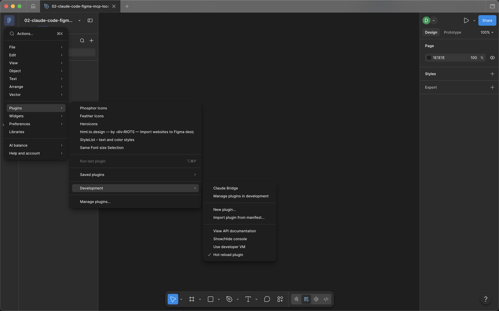
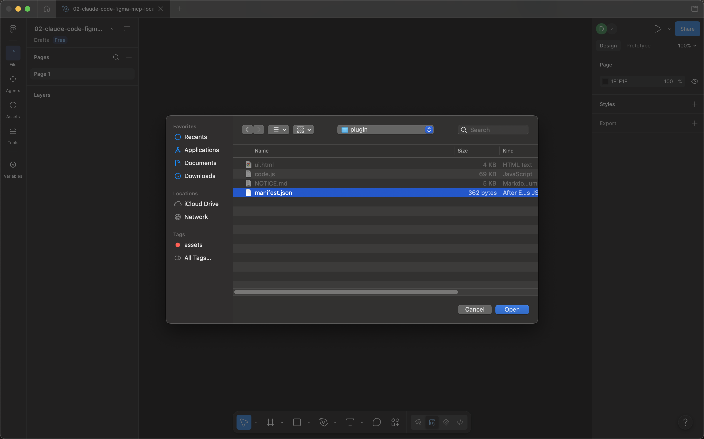
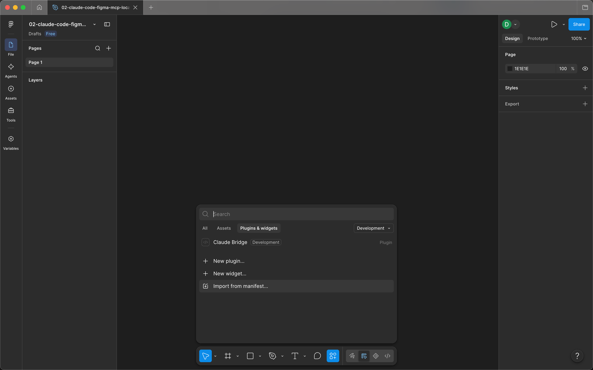
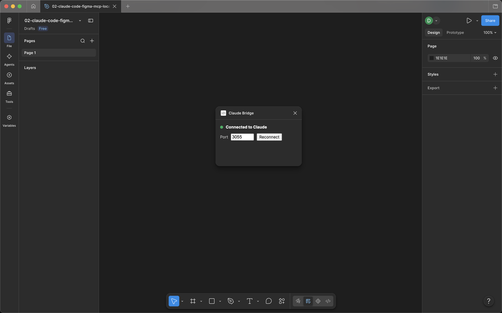
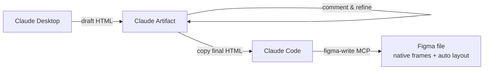
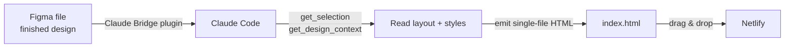
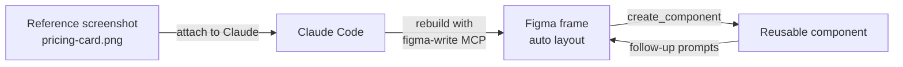
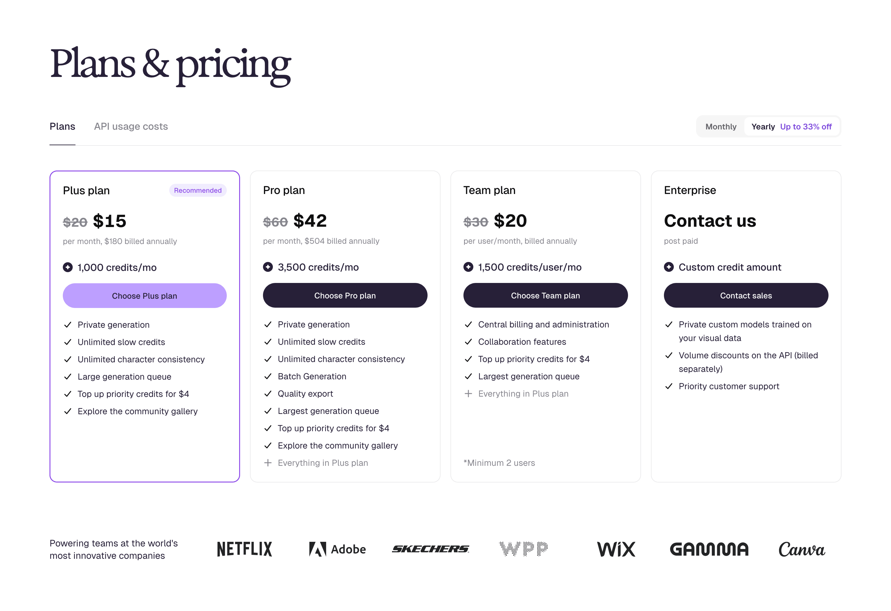
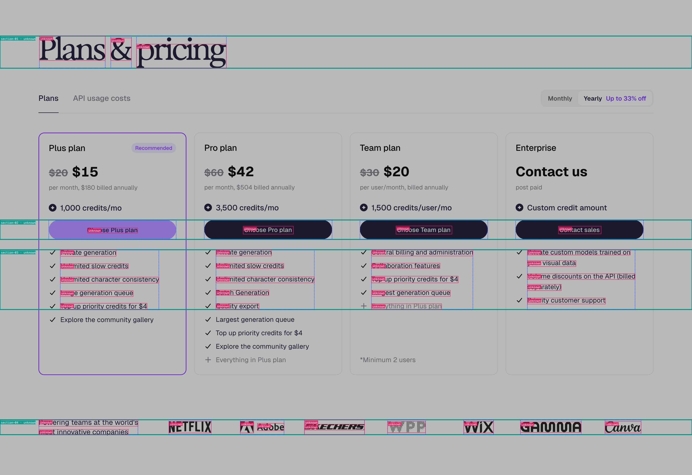

# figma-write-mcp (unofficial)

An MCP server that lets Claude create and edit designs directly in the **Figma desktop app**. Works on a **free Figma account** — no plugin publishing or approval required.

```
Claude (MCP client) ──stdio──> server.py ──WebSocket 127.0.0.1:3055──> Claude Bridge plugin ──> Figma Plugin API
```

---

## Quick Start

**Prerequisites:** Python 3.10+, Figma desktop app, Claude Desktop or Claude Code.

**1. Download** the latest release ZIP from GitHub and unzip it anywhere.

**2. Run the setup script:**

| Platform | Command |
|---|---|
| macOS / Linux | `bash setup.sh` |
| Windows | Right-click `setup.ps1` → *Run with PowerShell* |

The script installs Python dependencies into a local `.venv/`, then registers the MCP server with Claude automatically.

**3. Import the Figma plugin (one time):**

Open any Figma file, then from the top menu choose **Plugins → Development → Import plugin from manifest…**



In the file picker, navigate to the unzipped repo and select `plugin/manifest.json`.



Figma will add **Claude Bridge** to the Development group. You only need to do this once per machine — it then shows up in the Plugins panel (and under Plugins → Development in the top menu).



**4. Restart Claude** (Desktop or Code) to pick up the new MCP server.

**5. Start the plugin each session:**
**Plugins → Development → Claude Bridge** — a Token field will appear. Paste the token from `~/.figma-mcp-token` (created automatically on first server start). The token is saved in the plugin and only needs to be entered once per machine.

Wait for the green dot and *Connected to Claude*. Keep the window open while you work.



**Try it:** Ask Claude: *"Create a frame named Hero, 1440×900, on the current page."*

---

## Prerequisites

| Requirement | Version | Notes |
|---|---|---|
| Python | 3.10 or later | [python.org](https://www.python.org/downloads/) · macOS: `brew install python@3.12` · Windows: `winget install Python.Python.3.12` · Linux: `sudo apt install python3.12 python3.12-venv` |
| Figma desktop | any | Browser Figma does not support dev plugins |
| Claude Desktop or Claude Code | any | The setup script auto-detects which you have |
| Tesseract OCR | any | **Optional.** Only needed for `scripts/extract-geometry.py`. See [Optional OCR Scripts](#optional-ocr-scripts). |

---

## Workflows

Three recipes that show how this MCP fits a real design loop. Each is a short scenario, a flow diagram, and a prompt you can paste into Claude.

### 1. Artifact-first UI, then build it in Figma

**Scenario:** iterate on a UI as HTML in a Claude Artifact (fast visual feedback, easy to comment on), then port the agreed design into Figma as native layers.



**Prompt (Claude Code):**
> Here is an HTML mockup. Create a new page in the current Figma file named "Landing v1" and rebuild this layout as native Figma frames with auto layout. Use the colors and spacing from the HTML exactly. HTML follows: `<paste>`

### 2. Figma design → HTML ready for Netlify

**Scenario:** you already have a finished design in Figma and want shippable static HTML/CSS to drag-drop onto Netlify.



**Prompt (Claude Code):**
> Use `get_selection` and `get_design_context` to read my current Figma selection. Produce a single `index.html` with inline CSS that matches the layout, typography, and colors as closely as possible. Keep it responsive down to 375px. Output the file contents only.

### 3. Screenshot of a component → Figma component

**Scenario:** you have a PNG/JPG of a UI component from another product and want it rebuilt as a reusable Figma component.



**Prompt (Claude Code):**
> I've attached a screenshot of a pricing card. Rebuild it inside the current Figma file as a frame with auto layout, matching proportions, type sizes, and colors. When it looks right, call `create_component` on the frame so I can reuse it.

---

## Tools (57 total)

### Routing / Multi-file

| Tool | Description |
|---|---|
| `list_files` | List all Figma plugins currently connected to this server |
| `select_file` | Set the default target file for all subsequent calls in this session |
| `get_current_file` | Return the currently targeted file's metadata |

### Read

| Tool | Description |
|---|---|
| `get_document_info` | Pages and top-level nodes of the current page |
| `get_selection` | Nodes the user currently has selected |
| `get_node` | Details of a node and its children (depth-limited) |
| `get_page_frames` | Top-level frames with bounding boxes |
| `get_layout_tree` | Flat geometry-only node list (fast, no style data) |
| `get_design_context` | Design context tree with token-budget estimate |
| `get_variable_defs` | All local variable collections with modes and values |
| `get_styles` | All local paint, text, effect, and grid styles |
| `get_components` | Components on the current page (or all pages) |
| `get_viewport` | Current viewport state |
| `export_frame` | Render a frame/component as PNG, JPG, SVG, or PDF |

### Create

| Tool | Description |
|---|---|
| `create_frame` | Frame with optional auto layout |
| `create_rectangle` | Rectangle |
| `create_ellipse` | Ellipse / circle |
| `create_text` | Text layer |
| `create_image` | Image-filled rectangle from a local file path |
| `create_svg` | Import an SVG string as a vector node |
| `create_page` | New Figma page |
| `create_component` | Convert an existing frame into a reusable component |
| `create_component_set` | Combine component nodes into a variant set |
| `create_instance` | Place a component instance on the canvas |

### Edit — Text & Fill

| Tool | Description |
|---|---|
| `set_text` | Replace text in a text layer |
| `set_text_style` | Mutate typography (font, size, weight, line height, letter spacing) |
| `set_fill` | Solid fill color (`#RRGGBB` or `#RRGGBBAA`) |
| `set_gradient_fill` | Gradient fill or stroke |
| `set_image_fill` | Apply a local image file as a fill |
| `set_image_fill_bytes` | Apply a base64-encoded image as a fill |
| `set_stroke` | Solid stroke color and weight |
| `set_stroke_properties` | Advanced stroke (dash, cap, join, alignment) |
| `set_effects` | Shadows and blurs |
| `set_corner_radius` | Per-corner radius |

### Edit — Layout

| Tool | Description |
|---|---|
| `set_auto_layout` | Set or change auto-layout mode and alignment |
| `set_padding` | Per-side padding on an auto-layout frame |
| `set_item_spacing` | Gap between children in an auto-layout frame |
| `move_node` | Move a node to x/y |
| `resize_node` | Resize a node |
| `fit_to_content` | Resize a frame to tightly wrap its children |
| `distribute_horizontally` | Equal horizontal spacing between 3+ nodes |
| `distribute_vertically` | Equal vertical spacing between 3+ nodes |
| `align_to_grid` | Snap nodes to the nearest grid multiple |

### Edit — Structure

| Tool | Description |
|---|---|
| `rename_node` | Rename a node |
| `delete_node` | Delete a node |
| `delete_nodes` | Delete multiple nodes in one call |
| `clone_node` | Duplicate a node |
| `clone_nodes` | Duplicate multiple nodes in one call |
| `reparent_nodes` | Move nodes to a new parent (supports cross-page) |
| `group_nodes` | Wrap nodes in a group |
| `ungroup_node` | Ungroup, returning children to the parent |
| `set_node_visibility` | Show or hide a node |
| `set_variant_property` | Set variant properties on a component instance |

### Edit — Selection & Navigation

| Tool | Description |
|---|---|
| `select_and_zoom` | Select nodes and zoom the viewport to them |
| `set_selection` | Set selection without zooming |
| `set_page` | Switch the active page by name or ID |

### Batch

| Tool | Description |
|---|---|
| `run_batch` | Execute an ordered array of commands in one plugin round-trip. Later commands can reference prior results via `_ref:<alias>`. |

---

## Multi-file Usage

When you have the plugin open in more than one Figma file at the same time:

```
# See which files are connected
list_files()

# Set a default for all subsequent calls
select_file(fileKey="<fileKey from list_files>")

# Or target a specific file per call
create_frame(name="Hero", width=1440, height=900, fileKey="<fileKey>")
```

With only one plugin connected, `fileKey` is optional — all tools route automatically.

---

## Manual MCP Config

If the setup script doesn't detect your Claude installation, add the server manually.

**Claude Desktop** — edit `~/Library/Application Support/Claude/claude_desktop_config.json` (macOS) or `%APPDATA%\Claude\claude_desktop_config.json` (Windows):

```json
{
  "mcpServers": {
    "figma-write": {
      "command": "/ABSOLUTE/PATH/figma-write-mcp/.venv/bin/python",
      "args": ["/ABSOLUTE/PATH/figma-write-mcp/server.py"]
    }
  }
}
```

**Claude Code:**

```bash
claude mcp add figma-write -- /ABSOLUTE/PATH/figma-write-mcp/.venv/bin/python /ABSOLUTE/PATH/figma-write-mcp/server.py
```

**Important:** the `command` must point to `.venv/bin/python` (or `.venv\Scripts\python.exe` on Windows), not to your system `python3`. The venv Python has all the required packages.

---

## Port Configuration

Default port: **3055**. To use a different port:

1. Add `"env": {"FIGMA_MCP_PORT": "XXXX"}` to the MCP config entry.
2. Update `devAllowedDomains` in `plugin/manifest.json` to `ws://localhost:XXXX`.
3. In the Claude Bridge plugin window, change the port and click Reconnect.

---

## Optional OCR Scripts

`scripts/extract-geometry.py` uses computer vision to extract layout geometry from reference images. It is not required for any of the 57 MCP tools — only for manual geometry extraction workflows.

It requires the **Tesseract binary** (a system package) in addition to Python packages:

```bash
# 1. Install Tesseract
#    macOS:          brew install tesseract
#    Windows:        winget install UB-Mannheim.TesseractOCR
#    Ubuntu/Debian:  sudo apt install tesseract-ocr
#    Fedora:         sudo dnf install tesseract

# 2. Install OCR Python packages
.venv/bin/pip install -r scripts/requirements-ocr.txt
# Windows: .venv\Scripts\pip install -r scripts\requirements-ocr.txt
```

### Demo

A two-step pipeline turns a reference image into an annotated overlay you can eyeball:

```bash
# 1. Extract geometry → JSON (bounding boxes with confidence + source tags)
.venv/bin/python scripts/extract-geometry.py docs/images/ocr-input.png /tmp/spec.json

# 2. Composite the boxes back onto a dimmed copy of the reference
node scripts/render-layout-overlay.js docs/images/ocr-input.png /tmp/spec.json docs/images/ocr-overlay.png
```

**Input — raw reference image:**



**Output — detected sections, columns, and cells overlaid on the reference:**



> `extract-geometry.py` emits JSON only; the overlay PNG is produced by `scripts/render-layout-overlay.js`. Teal boxes are sections, blue are columns, magenta are cells, amber indicates low confidence (< 0.6).

**Known limitations.** The detector is whitespace-first and contour-second, so it works best on layouts with high-contrast, hard-edged separators. Expect degraded accuracy on:

- **Soft-outlined cards** (1px light-gray borders, large radii, drop shadows instead of strokes) — adjacent cards bleed into one column because the whitespace gap is below the variance threshold.
- **Low-contrast UI** (dark-on-dark, light-on-light, subtle tints) — column and cell boundaries get missed or merged.
- **Small elements** (icons, checkmarks, badges, 12px chips, inline logos) — fall below the minimum cell size and are either dropped or absorbed into the parent cell.
- **Overlapping / floating elements** (modals, tooltips, sticky headers over content) — treated as part of the section underneath, not as their own region.
- **Dense text blocks without clear gutters** — OCR paragraph grouping (if Tesseract is installed) helps, but tightly-packed lists may still split awkwardly.

Treat the output as a layout scaffold, not a pixel-perfect spec. Use it to seed `create_frame` / `create_rectangle` calls, then refine inside Figma.

---

## Adding a Tool

1. Add a handler in `plugin/code.js` under `const handlers = { ... }` that uses the [Figma Plugin API](https://www.figma.com/plugin-docs/api/api-reference/).
2. Register it in `server.py` with `@mcp.tool(description="...")` and a matching `async def` that calls `_forward("tool_name", args)`.
3. Restart your MCP client and re-run the plugin.

---

## Security

The server only listens on `127.0.0.1` (loopback), so it is not reachable from other machines on your network. Several additional defences are active:

| Defence | What it blocks |
|---|---|
| Loopback-only bind | Remote machines on the same Wi-Fi |
| Origin header allowlist | DNS-rebinding attacks from browser tabs |
| Shared secret token | Local processes impersonating the Figma plugin |
| Ping-before-replace | A second plugin silently stealing an open connection |
| `realpath` on image paths | Symlink traversal when loading image files |

**Token setup (first run):**
On first start, the server writes a random token to `~/.figma-mcp-token` (macOS/Linux) or reads `FIGMA_MCP_TOKEN` from the environment. Open the Claude Bridge plugin, paste the token into the Token field, and click Reconnect. The plugin stores it in `localStorage` so you won't need to re-enter it.

To rotate the token, delete `~/.figma-mcp-token` and restart the server, then re-enter the new token in the plugin.

**Known risk — prompt injection via layer content:**
Layer names and text inside Figma designs are passed to the AI without filtering. A malicious file could include text that attempts to steer the AI's actions. Mitigation: avoid opening untrusted Figma files while the server is running.

**Emergency bypass:**
If the Origin check blocks your setup (e.g. a custom Figma environment), set `FIGMA_MCP_ALLOW_ALL_ORIGINS=1` in the server's environment. This disables the DNS-rebinding defence — only use it on a trusted network.

---

## Troubleshooting

- **Plugin shows "Rejected: wrong token or origin"** — paste the token from `~/.figma-mcp-token` into the Token field in the plugin and click Reconnect. If the file doesn't exist, restart the server once to generate it.
- **"Figma plugin is not connected"** — run the Claude Bridge plugin in the open Figma file (Plugins → Development → Claude Bridge).
- **Plugin shows "MCP server not running"** — Claude hasn't started the server yet. Check MCP logs, or run `.venv/bin/python server.py` directly to see errors.
- **"Multiple plugins connected; pass fileKey"** — you have the plugin open in more than one file. Call `list_files()` then `select_file(fileKey=...)`.
- **Python version too old** — run `python3 --version`. If below 3.10, install a newer version and re-run `setup.sh`.
- **"command not found: python3"** — on Windows use `py` instead, or add Python to PATH during install.
- **Permission denied on setup.sh** — run `chmod +x setup.sh` first, then `bash setup.sh`.
- **PowerShell execution policy error** — run `powershell -ExecutionPolicy Bypass -File setup.ps1`, or open PowerShell as Administrator and run `Set-ExecutionPolicy RemoteSigned -Scope CurrentUser`.
- **MCP config not working after manual edit** — verify `command` points to `.venv/bin/python`, not `python3`. The venv Python must be used.
- **Port 3055 in use** — see [Port Configuration](#port-configuration).
- **Font errors** — font family and style must be installed and named exactly as they appear in Figma's font picker (e.g. `Semi Bold`, not `SemiBold`).

---

## Free Plan Notes

Development plugins run on every Figma plan. Free-plan limits still apply to your files (3 design files in drafts, etc.). All edits go into Figma's normal undo history — press Cmd/Ctrl+Z to undo anything Claude does.
